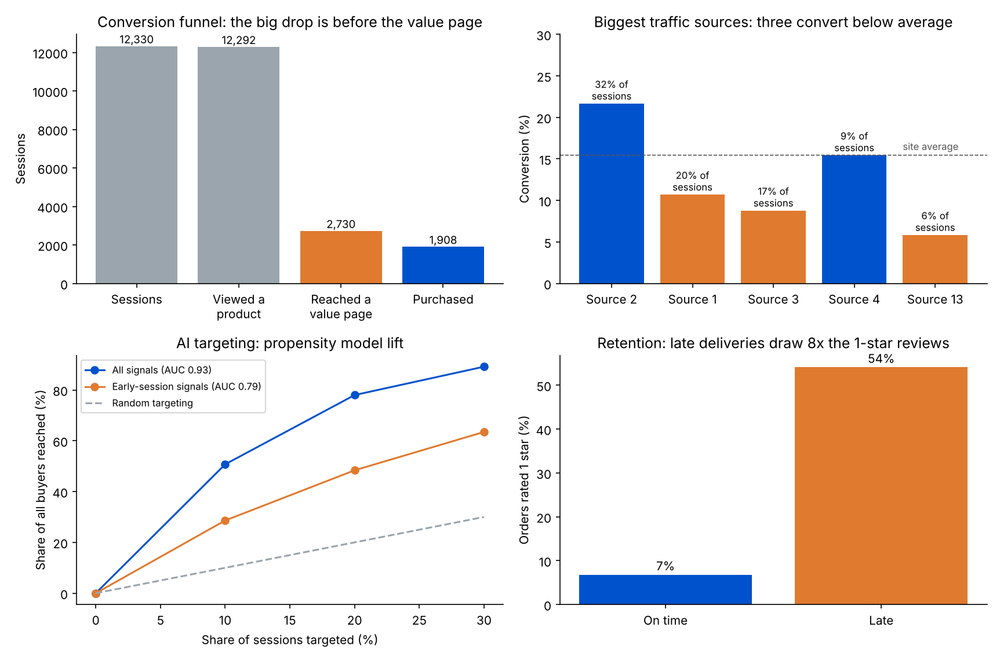

# E-commerce Growth Funnel: Conversion, Retention and AI Targeting

A growth-strategy analysis of an online store’s customer funnel across **acquisition, conversion and retention**, using two real public datasets:

- **12,330 browsing sessions** from a year of traffic on an online store (UCI Online Shoppers Purchasing Intention dataset), for acquisition and conversion.
- **99,441 orders** from Olist, a Brazilian e-commerce marketplace (public dataset), for retention.

It finds where customers drop off, sizes the growth levers and builds a purchase-propensity model to show how AI can target campaigns.



## Key findings

| Funnel stage | Finding | Growth lever |
|---|---|---|
| Conversion: the drop-off | 99.7% of sessions view a product, but only **22%** reach a page that has led to past purchases (a “value page”, PageValues > 0 in the data), so **78%** drop out at this step. Sessions that reach one convert at **56%**, versus **3.9%** for those that do not. | Get more product viewers to a value page: recommendations, clearer product pages, cart prompts |
| Acquisition: traffic quality | Three of the five biggest traffic sources (1, 3 and 13) bring **43%** of all sessions but convert at **5.8–10.7%**, against a **15.5%** site average. | Raising just those three to the average would add **326 purchases (+17%)** at the same traffic |
| Visitors | Returning visitors are **86%** of sessions but convert at **13.9%**; new visitors convert at **24.9%**. | Re-engage returning visitors, who browse often but buy less often |
| Seasonality | **November** converts best (**25%**) and brings **40%** of the year’s purchases; February converts **1.6%**. | Concentrate campaign budget on peak months |
| AI targeting | A gradient-boosting propensity model (5-fold cross-validated) using only early-session behaviour reaches **48% of buyers by targeting the top 20%** of sessions (AUC **0.79**), 2.4x random. With all signals, the top 20% hold **78%** of buyers (AUC **0.93**). | Spend retargeting and offers on the highest-propensity sessions instead of everyone |
| Retention | Only **3.0%** of Olist customers ever order again (**4.0%** of those with at least 6 months to come back); the median gap to a second order is **28 days**. | Retention is the weakest stage: each extra point of repeat rate is about **934 orders (BRL 149K)** |
| Delivery and retention | **6.8%** of orders arrive late. Late orders average **2.3 stars** against **4.3** on time, get **8x** the share of 1-star reviews (**54%** vs **7%**), and their customers repeat **19%** less often. | Delivery promises and accuracy protect reviews and repeat purchases |

## Method

**Funnel.** Session → viewed a product page → reached a value page (PageValues > 0) → purchased. Drop-off is the share of sessions lost between stages. Conversion = purchases ÷ sessions.

**Traffic lever.** For each of the five largest traffic sources converting more than 2 points below the site average, extra purchases = (site average conversion − source conversion) × source sessions. Source 4 converts at 15.4%, essentially at the average, so it is left out.

**Propensity model.** `HistGradientBoostingClassifier` predicting purchase per session, scored with 5-fold stratified cross-validation so every prediction comes from a model that never saw that session. Two versions:
- **All signals**, including PageValues.
- **Early-session signals**, without PageValues. PageValues is computed from the pages a visitor has already passed on the way to a purchase, so it is only known late in a session. This is the version a live campaign could use.

Capture at x% = share of all buyers inside the top x% of sessions by predicted probability.

**Retention.** Olist delivered orders linked to each customer’s unique ID. Repeat rate = share of customers with two or more orders. Late = delivered after the estimated date shown at purchase. Review score = the average review for the order.

**Business case.** One extra point of repeat rate = 1% of the 93,350 customers placing one more order at the average order value of BRL 160.

## Limitations

- The two datasets come from different stores and markets, so each answers its own part of the funnel; they are not joined.
- Traffic sources are anonymised codes in the dataset, so the analysis cannot say which channel each one is.
- The delivery findings are associations: late orders differ from on-time orders in other ways, such as region and product. A controlled test would be needed to prove cause.
- The propensity model is scored on historical sessions; a real campaign would A/B test the targeted offer before scaling.

## Run it

```bash
pip install pandas numpy scikit-learn matplotlib
python run_analysis.py   # writes results/results.json (~1 minute)
python make_charts.py    # writes results/summary.png
```

## Data sources

- Sakar, C.O., Polat, S.O., Katircioglu, M. and Kastro, Y. (2019), “Real-time prediction of online shoppers’ purchasing intention using multilayer perceptron and LSTM recurrent neural networks”, Neural Computing and Applications. Data: UCI Machine Learning Repository, Online Shoppers Purchasing Intention dataset.
- Olist, Brazilian E-Commerce Public Dataset (Kaggle), orders, customers, payments and reviews tables, 2016–2018.
